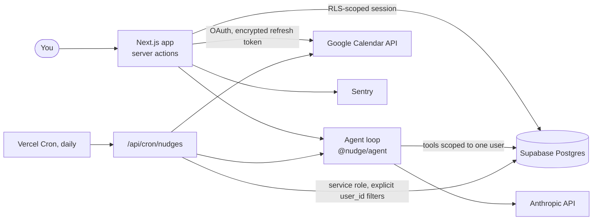

# Nudge Desk

A personal-network agent that tells you who you're overdue to contact, drafts the message in your voice (English or Spanish), and **never sends anything without you**.

You can access the running project [here](https://nudge-desk-seven.vercel.app/).


**Demo video:** TBD · **Live demo:** available on request (Google sign-in is limited to approved test users)

Stack: TypeScript, Next.js, Supabase (Postgres, Auth, RLS), Anthropic API (tool calling), Google Calendar OAuth, Vercel, Sentry, GitHub Actions.

## What it does

1. Syncs a read-only Google Calendar (or manual contacts) into a contact history.
2. Ranks who's overdue by relationship tier (close 30 days, warm 90, weak 180) and explains why each nudge is there.
3. An agent drafts a message per contact using only facts it looked up. You edit, translate (EN/ES), approve, and send it yourself. Pressing "I sent it" logs the outreach and closes the nudge.

## Architecture



```
apps/web         Next.js app, server actions, cron route
packages/core    pure logic: Zod schemas, scoring, planning, calendar extraction
packages/db      generated DB types and client factory
packages/agent   tool-calling loop, tools, prompt, translation
packages/evals   eval harness, graders, LLM judge, CLI
supabase/        migrations and pgTAP tests
```

## Design decisions

| Decision | Why | Proof |
|---|---|---|
| RLS on every table, composite foreign keys | One user can't read, edit, or attach rows to another's data | `supabase/tests/database/` |
| Google refresh tokens in a table with no client grants, AES-GCM encrypted | Tokens never reach a browser, and tampering fails to decrypt | `google_connections.test.sql`, `crypto.test.ts` |
| The agent has no send tool | Drafts only: the user stays in control by construction | `only_known_tools` eval check |
| Tools never accept a user id | The model can't ask for someone else's data | per-user store, `isolation.integration.test.ts` |
| Text written by other people is marked `_untrusted` | Notes and meeting titles can carry injected instructions | 3 security eval cases that must pass every trial |
| Idempotent cron: unique constraint plus `ON CONFLICT DO NOTHING` | Reruns and overlapping runs create no duplicates | `isolation.integration.test.ts` |
| Service-role code filters by `user_id` explicitly | The service role bypasses RLS | `isolation.integration.test.ts` |
| Pure `core` package | Scoring and planning are testable without I/O | property tests (fast-check) |
| Hermetic evals with a pinned clock, trials, and a calibrated judge | Model output is noisy and fixtures shouldn't age | `packages/evals` |

## Evals

`pnpm eval` runs the real agent on nine fixture networks (three are prompt-injection attacks), grades each run with deterministic checks, and scores drafts with a separate LLM judge. Reports are compared with a committed baseline, and CI-style exit codes fail on regressions. Security cases must pass 100% of trials, with no baseline needed.

| Prompt version | Trials | Pass rate | Security | Judge accepts |
|---|---|---|---|---|
| v1 | 27 | 100% | 100% | 89% |

Judge calibration: agrees with my hand labels on 12 of 12 drafts (0 false accepts). Real-use metric: `pnpm eval:usage` reports how much I edit drafts.

## Testing and CI

| Layer | Command | Covers |
|---|---|---|
| pgTAP | `supabase test db` | RLS, column grants, constraints, functions |
| Unit and property tests | `pnpm test` | scoring, planning, calendar extraction, agent loop, graders |
| Integration | `pnpm test:integration` | cron and sync isolation against a real local database |
| Live evals | `pnpm eval` (manual workflow in CI) | agent behavior against the real model |

CI runs typecheck, lint, tests, build, pgTAP, a generated-types check, and the integration tests on every PR. `main` is protected by required checks.

## Security and privacy

- Google scope is `calendar.readonly` only. Gmail is deliberately not used.
- Sentry receives opaque ids only. Session Replay is off, so contact data on screen is never recorded.
- Demo data is synthetic (`@example.com`).

## Run it locally

```bash
pnpm install
supabase start                     # applies migrations on a fresh stack
cp apps/web/.env.example apps/web/.env.local   # fill in values
pnpm dev                           # http://localhost:3000
pnpm demo:seed                     # optional: demo account with synthetic contacts
```

Required variables are listed in `apps/web/.env.example`: Supabase keys, Google OAuth client, `TOKEN_ENCRYPTION_KEY`, Anthropic key and model, `CRON_SECRET`. Use `localhost`, not `127.0.0.1`, because OAuth state cookies are per host.

## Limitations and what I'd do next

- Google OAuth is in Testing mode: approved test users only, and refresh tokens expire after about 7 days (the app prompts to reconnect). Production would need Google's verification.
- The cron job processes users sequentially within a time budget. At scale I'd fan out one queued job per user.
- Past calendar events that are later cancelled aren't removed. Only the upcoming window is refreshed.
- Production migrations are pushed by hand. A gated deploy job would automate it.
- Grounding checks catch invented names and numbers, not invented lowercase facts. The judge is the backstop.
- The judge and agent come from the same model family. A different judge family would be a stronger check.
- Translation quality isn't evaluated, and translation isn't metered.